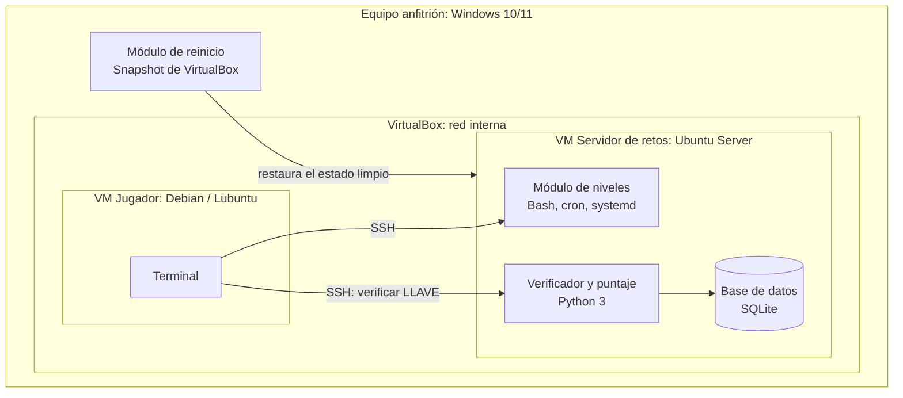
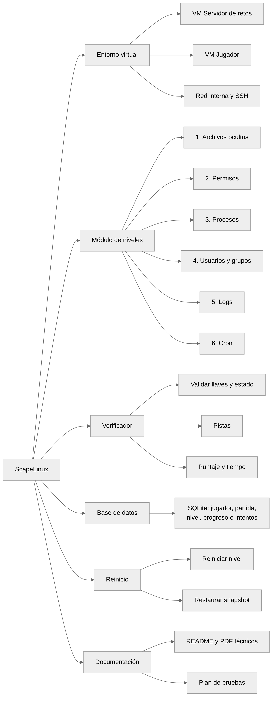
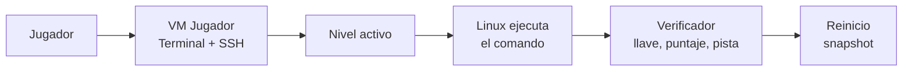
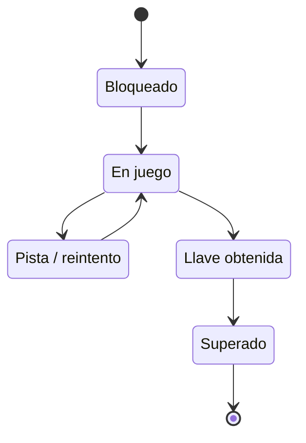
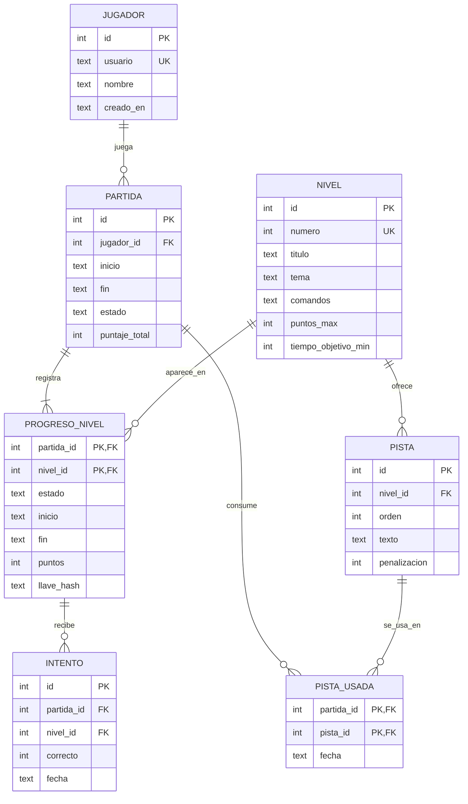
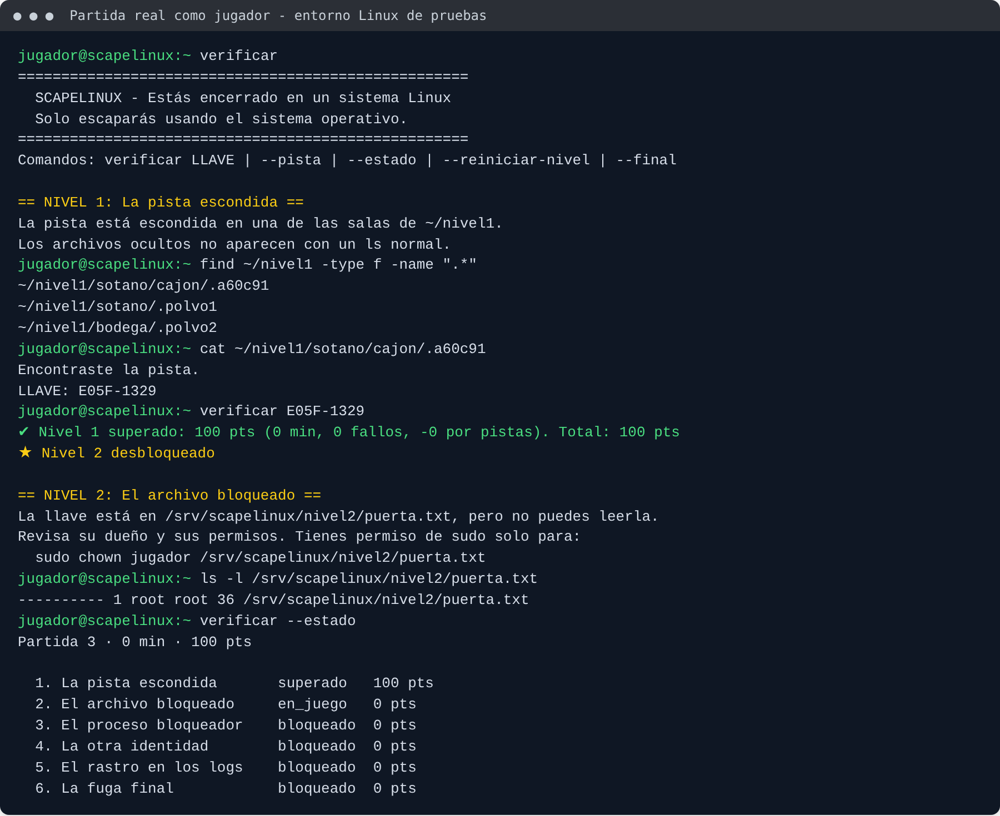
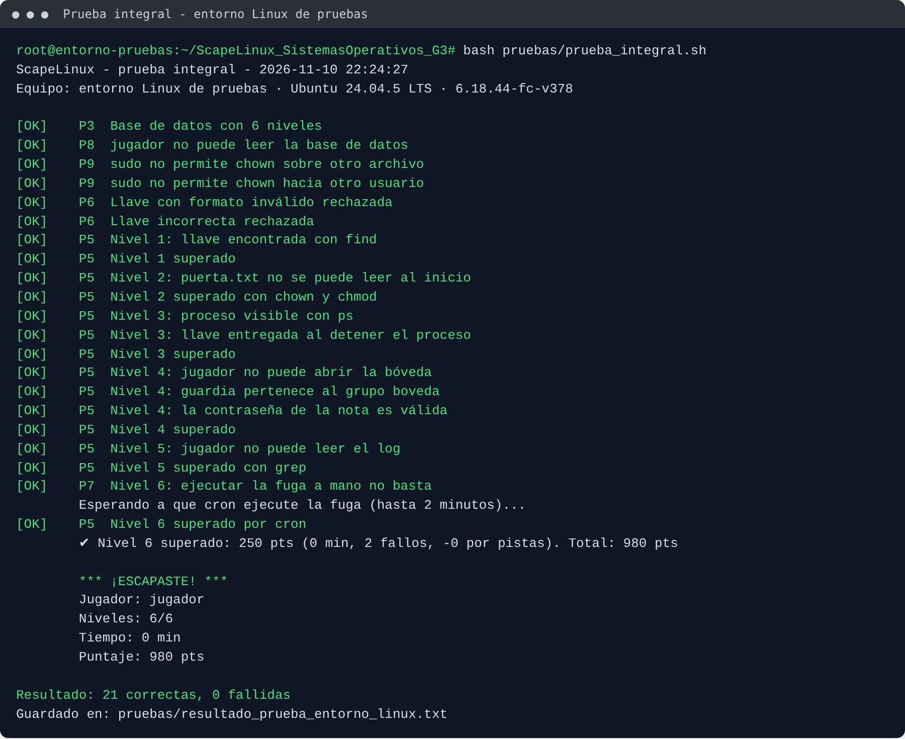
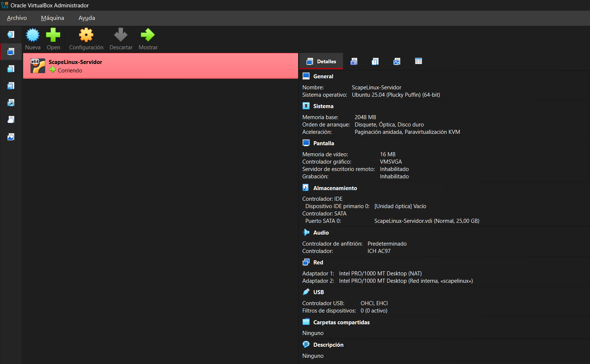
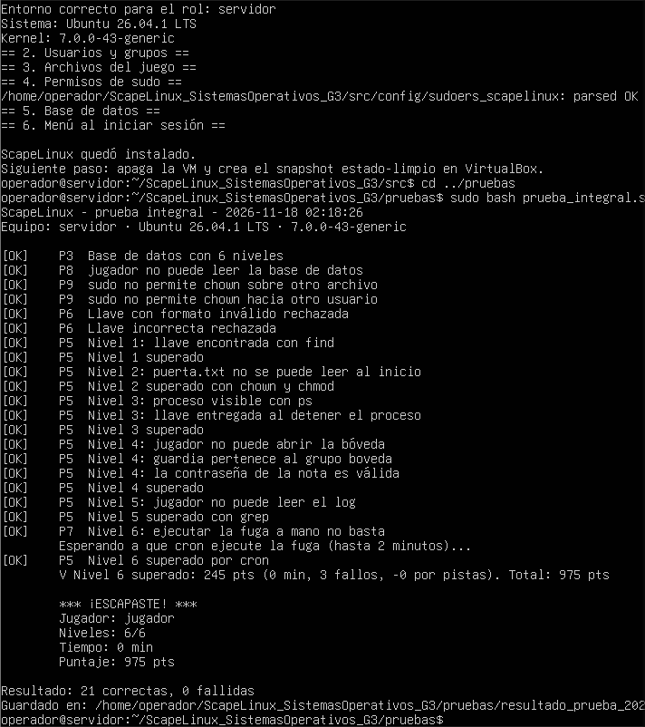
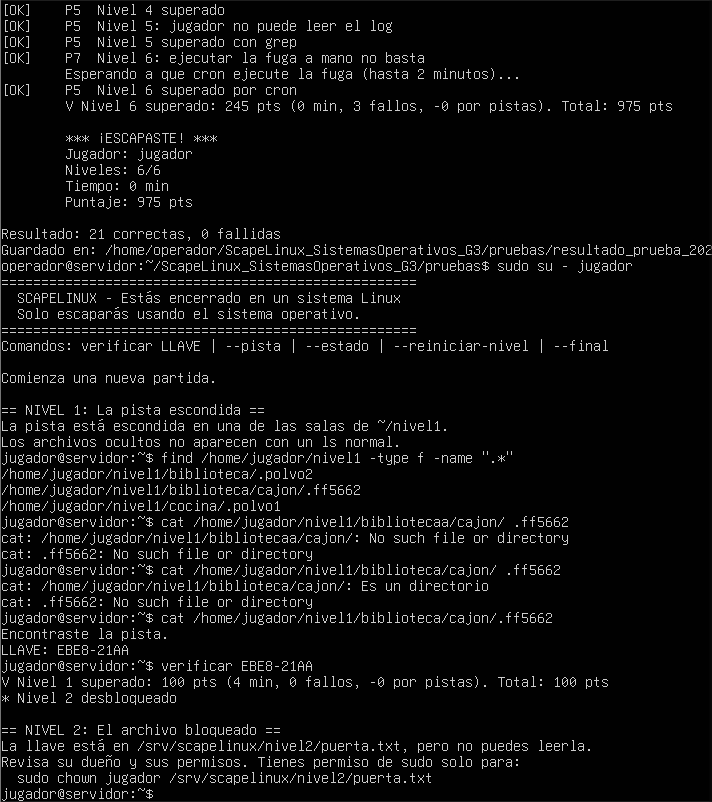

# ScapeLinux

Juego de simulación en máquinas virtuales para aprender Linux resolviendo retos con comandos reales.

| | |
|---|---|
| **Universidad** | Universidad Manuela Beltrán |
| **Asignatura** | Sistemas Operativos |
| **Grupo** | G3 |
| **Repositorio** | [ScapeLinux_SistemasOperativos_G3](https://github.com/juanchis1018-web/ScapeLinux_SistemasOperativos_G3) |
| **Integrantes** | Juan Sebastian Muñoz Melo · Maria Luisa Silva Santiago |
| **Estado** | Versión final: el juego está implementado, instalado y probado en VirtualBox con Ubuntu Server 26.04.1 LTS. La prueba integral pasó 21 de 21 controles. |

## Contenido

1. [Resumen](#1-resumen)
2. [Levantamiento de información](#2-levantamiento-de-información)
3. [Descripción del proyecto](#3-descripción-del-proyecto)
4. [Estructura del prototipo](#4-estructura-del-prototipo)
5. [Validación de niveles y puntaje](#5-validación-de-niveles-y-puntaje)
6. [Seguridad y aislamiento](#6-seguridad-y-aislamiento)
7. [Compatibilidad entre distribuciones](#7-compatibilidad-entre-distribuciones)
8. [Recuperación](#8-recuperación)
9. [Tecnologías](#9-tecnologías)
10. [Requisitos iniciales de ejecución](#10-requisitos-iniciales-de-ejecución)
11. [Resultado esperado y alcance](#11-resultado-esperado-y-alcance)
12. [Fase II: implementación y pruebas](#12-fase-ii-implementación-y-pruebas)
13. [Documentación](#13-documentación)
14. [Ajustes por la revisión del docente](#14-ajustes-por-la-revisión-del-docente)
15. [Versión final: resultados y conclusiones](#15-versión-final-resultados-y-conclusiones)

---

## 1. Resumen

**Contexto.** ScapeLinux es un juego tipo escape room que encierra al jugador en un sistema Linux del que solo sale usando el sistema operativo. Cada reto entrega una llave que abre el siguiente, hasta completar seis niveles y escapar.

**Parte técnica.** El juego corre en dos máquinas virtuales de VirtualBox conectadas por una red interna. Una VM con Ubuntu Server contiene los retos y la otra, con Debian o Lubuntu, es la terminal desde la que el jugador entra por SSH. Los niveles se preparan con Bash, cron y systemd; un verificador en Python valida las llaves y lleva puntaje y tiempo en SQLite; y un snapshot devuelve el servidor a su estado inicial.

## 2. Levantamiento de información

### Situación actual

Conceptos de sistemas operativos como archivos, permisos, procesos, usuarios y tareas programadas suelen verse solo en teoría. Practicarlos en el equipo personal genera miedo de dañarlo.

### Problemática

| Situación observada | Consecuencia |
|---|---|
| Los temas se quedan en la teoría | Cuesta relacionar los conceptos con un sistema real |
| Da miedo usar la terminal en el equipo personal | Se practica poco o no se practica |
| Un error en el sistema propio puede tener consecuencias | No se aprende probando y equivocándose |
| Hay poca práctica con permisos, procesos y usuarios | Los comandos se memorizan sin entender qué hacen |

### Necesidad

Se requiere una herramienta que permita:

- Practicar comandos reales de Linux en un entorno aislado y seguro.
- Aplicar permisos, usuarios y grupos sobre un sistema real.
- Observar y controlar procesos y señales del sistema.
- Aprender de forma entretenida, con retos progresivos.
- Equivocarse y reiniciar sin consecuencias gracias a la virtualización.

### Justificación de la solución

La virtualización permite trabajar sobre un Linux real sin tocar el equipo anfitrión. Si el jugador se equivoca, restaura un snapshot y vuelve a empezar. El formato de juego da a cada tema de la asignatura un reto concreto y un resultado que se puede comprobar. Además, es una solución gratuita y realizable en un mes.

### Usuarios y beneficiarios

- **Estudiantes** que están aprendiendo sistemas operativos o Linux.
- **Docentes** que necesiten una práctica guiada y repetible.

## 3. Descripción del proyecto

### Objetivo general

Desarrollar un juego tipo escape room ejecutado en máquinas virtuales Linux, donde el jugador supere niveles aplicando comandos reales sobre archivos, permisos, procesos, usuarios y tareas programadas, para comprender de forma práctica y segura cómo funciona un sistema operativo.

### Objetivos específicos

1. Configurar un entorno de dos máquinas virtuales Linux, aislado del equipo anfitrión.
2. Diseñar seis niveles progresivos sobre archivos, permisos, procesos, usuarios, logs y tareas programadas.
3. Implementar un verificador que valide cada reto y registre pistas, puntaje y tiempo.
4. Definir mecanismos de seguridad y recuperación para reiniciar el juego sin afectar el anfitrión.
5. Documentar la instalación, las reglas y las pruebas para que el proyecto pueda reproducirse.

### Funcionalidades principales

- Iniciar la partida y conectarse al servidor por SSH.
- Resolver seis retos con comandos reales de Linux.
- Validar llaves y desbloquear niveles en orden.
- Pedir pistas y consultar puntaje y tiempo.
- Reiniciar un nivel o restaurar el servidor desde un snapshot.

### Niveles

Antes del primer nivel, el jugador inicia la partida desde la VM Jugador y se conecta al servidor por `ssh`.

| Nivel | Reto | Tema | Comandos |
|---|---|---|---|
| 1 | Encontrar la pista escondida | Archivos ocultos | `ls -a`, `find` |
| 2 | Abrir un archivo bloqueado | Permisos y dueños | `chmod`, `chown` |
| 3 | Detener el proceso que bloquea la puerta | Procesos y señales | `ps`, `kill` |
| 4 | Cambiar de usuario y descubrir permisos de grupo | Usuarios y grupos | `su`, `groups` |
| 5 | Buscar la clave registrada en los logs | Registros del sistema | `grep` en `/var/log` |
| 6 | Programar la fuga final, escapar y ver el puntaje total | Tareas programadas | `cron` |

### Relación con los conceptos de Sistemas Operativos

| Concepto | Cómo se aplica en ScapeLinux |
|---|---|
| Sistema de archivos | Búsqueda de archivos ocultos y recorrido de directorios en el nivel 1 |
| Permisos y protección | Dueños y permisos en el nivel 2, y acceso restringido a la base de datos |
| Procesos y señales | Identificación de procesos y envío de señales en el nivel 3 |
| Usuarios y grupos | Cambio de identidad y permisos de grupo en el nivel 4 |
| Registros del sistema | Búsqueda de eventos en logs en el nivel 5 |
| Tareas programadas | Programación de trabajos con cron en el nivel 6 |
| Servicios | Control de los procesos del juego con systemd |
| Virtualización | Aislamiento del juego mediante VMs, red interna y snapshots |
| Comunicación entre equipos | Acceso remoto al servidor por SSH |

### Requerimientos funcionales

- Mostrar un menú de inicio con las instrucciones del juego.
- Ofrecer seis niveles, cada uno con un reto de sistemas operativos.
- Entregar una llave al resolver cada nivel.
- Validar la llave y desbloquear el siguiente nivel.
- Dar pistas y llevar puntaje y tiempo.
- Crear procesos "trampa" y tareas cron controladas.
- Reiniciar la partida desde un snapshot.

### Requerimientos no funcionales

- Entorno aislado que no afecte al equipo anfitrión.
- Ligero: cada VM funciona con 2 GB de RAM.
- Reinicio completo en menos de un minuto.
- Mensajes claros y dificultad progresiva.
- Scripts modulares y comentados.
- Manual de usuario y guía de instalación (README).
- Ejecución en Windows 10/11 con VirtualBox.

## 4. Estructura del prototipo

### Arquitectura



| Componente | Descripción | Tecnología |
|---|---|---|
| Equipo anfitrión | PC físico donde corre todo el entorno virtual | Windows 10/11 |
| Hipervisor | Crea, aísla y conecta las máquinas virtuales | VirtualBox, red interna |
| VM Servidor de retos | Contiene niveles, archivos, usuarios y procesos del juego | Ubuntu Server, sin interfaz gráfica |
| VM Jugador | Terminal desde la que el jugador se conecta y juega | Debian / Lubuntu, SSH |
| Módulo de niveles | Prepara cada reto: archivos ocultos, permisos, procesos y logs | Scripts Bash, cron, systemd |
| Verificador y puntaje | Valida llaves, da pistas, suma puntos y mide el tiempo | Python 3 |
| Base de datos | Guarda partidas, progreso, intentos y pistas usadas | SQLite |
| Módulo de reinicio | Devuelve el servidor a su estado limpio inicial | Snapshots de VirtualBox |

### Estructura del producto



### Módulos funcionales

| Módulo | Responsabilidad | Ubicación prevista |
|---|---|---|
| Niveles | Crear, limpiar y comprobar cada reto | `src/niveles/` |
| Verificador | Validar llaves y estado, dar pistas y calcular el puntaje | `src/verificador/` |
| Base de datos | Guardar partidas, progreso, intentos y pistas | `src/base_datos/` |
| Comprobación del entorno | Detener la ejecución fuera de una VM de VirtualBox | `src/scripts/` |
| Instalador | Crear usuarios, permisos, servicio, base de datos y menú | `src/instalar.sh` |
| Reinicio | Recrear un nivel o restaurar el snapshot | Verificador y VirtualBox |

### Front: interfaz de terminal

El proyecto no tiene interfaz gráfica ni web. El front es la terminal de la VM Jugador, con el menú y los mensajes que muestra el juego. Este es un boceto de cómo se verá un nivel:

```text
== NIVEL 3: El proceso bloqueador ==
La puerta no abre: un proceso la retiene.
jugador@escape:~$ ps aux | grep puerta
jugador 1337 ... /opt/scapelinux/puerta_bloqueada
jugador@escape:~$ kill 1337
✔ Puerta abierta · LLAVE: 7F-K3
jugador@escape:~$ verificar 7F-K3
★ Nivel 4 desbloqueado · 320 pts
```

### Funcionamiento

Recorrido de una partida:



Ciclo de cada nivel. Al superar el nivel 6 el jugador escapa, y el snapshot permite volver a empezar.



### Base de datos

El verificador usa **SQLite**, que no necesita un servidor aparte y funciona con el módulo `sqlite3` que ya trae Python. Los retos no se guardan aquí: ocurren en el propio Linux. La base solo registra el avance del juego, y su acceso queda reservado al verificador para que el jugador no pueda leer las llaves ni cambiar su puntaje.

El esquema completo está en [`src/base_datos/esquema.sql`](src/base_datos/esquema.sql).

### Modelo relacional



| Tabla | Qué guarda |
|---|---|
| `jugador` | Quién juega |
| `nivel` | Los seis niveles, sus puntos y su tiempo objetivo |
| `pista` | Las pistas de cada nivel y cuánto restan al puntaje |
| `partida` | Cada intento completo del juego, con su tiempo y puntaje |
| `progreso_nivel` | El estado de cada nivel dentro de una partida y el hash de su llave |
| `intento` | Cada llave ingresada y si fue correcta |
| `pista_usada` | Las pistas que pidió el jugador en cada partida |

### Commits

El trabajo se registra en la rama `main` con commits cortos que dicen qué se hizo. Este es el plan por semana:

| Semana | Trabajo | Commit previsto |
|---|---|---|
| 1 | Instalar las VMs y la red, y diseñar los niveles | `Configura VMs y red interna` |
| 2 | Programar los niveles 1 a 3 y sus validaciones | `Agrega niveles 1 a 3` |
| 3 | Programar los niveles 4 a 6, llaves, puntaje y reinicio por nivel | `Agrega niveles 4 a 6 y verificador` |
| 4 | Pruebas de compatibilidad y recuperación, snapshots, manual y presentación | `Agrega pruebas y manual de usuario` |

En la Fase II el trabajo se registró por componentes: niveles, verificador, instalador, pruebas y documentación.

### Organización del repositorio

```text
ScapeLinux_SistemasOperativos_G3/
├── README.md
├── LICENSE
├── .gitignore
├── .gitattributes                 Conserva los saltos de línea de Linux
├── documentacion/
│   ├── guia_instalacion_vm.md     Montaje de las VMs paso a paso
│   ├── descripcion_proyecto.pdf
│   ├── requerimientos.pdf
│   ├── arquitectura_inicial.pdf
│   ├── tecnologias_herramientas.pdf
│   ├── referencias.pdf
│   └── diagramas/                 Estructura, arquitectura, flujo y datos
├── src/
│   ├── instalar.sh                Instalador del juego en la VM Servidor
│   ├── niveles/
│   │   ├── comun.sh               Funciones comunes
│   │   ├── nivel1.sh … nivel6.sh  Preparar, limpiar y comprobar cada reto
│   │   └── bin/                   puerta_bloqueada, abrir_puerta y fuga
│   ├── verificador/
│   │   └── scapelinux.py          Verificador en Python
│   ├── config/                    Servicio systemd, reglas de sudo y comando verificar
│   ├── base_datos/
│   │   └── esquema.sql            Modelo relacional y pistas
│   └── scripts/
│       └── comprobar_entorno.sh   Bloquea la ejecución fuera de una VM
├── recursos/
│   └── imagenes/                  Ficha técnica y evidencias
└── pruebas/
    ├── README.md                  Plan y resultados de las pruebas
    ├── test_verificador.py        Pruebas unitarias
    ├── prueba_integral.sh         Juega los seis niveles automáticamente
    └── resultado_prueba_entorno_linux.txt
```

Las VMs exportadas (`.ova`) no van en el repositorio, porque son demasiado pesadas para GitHub.

## 5. Validación de niveles y puntaje

### Reglas generales

- **Una llave por partida.** El verificador genera cada llave al azar y guarda solo su hash SHA-256. Una llave de otra partida no sirve.
- **Un nivel a la vez.** Los archivos y procesos de un nivel se crean cuando se desbloquea, así que no se puede buscar antes la llave de un nivel posterior.
- **Llave más estado del sistema.** Cuando el reto cambia el sistema, el verificador comprueba ese cambio además de la llave.
- **Sin acceso a las respuestas.** La base de datos solo la lee `root` (permisos `600`) y el jugador no puede modificar los programas del juego. Las llaves se pasan a los scripts por la entrada estándar, para que no aparezcan en `ps`.

### Criterio de cada nivel

| Nivel | Se completa cuando | Cómo se evita saltarse el procedimiento |
|---|---|---|
| 1. Archivos ocultos | La llave coincide | El archivo oculto cambia de ubicación en cada partida |
| 2. Permisos | La llave coincide y `puerta.txt` pertenece a `jugador` y tiene permiso de lectura para él | El archivo inicia sin permisos y `sudo` solo autoriza el `chown` exacto de ese archivo |
| 3. Procesos | La llave coincide y el servicio `puerta_bloqueada` está inactivo | La llave se escribe solo cuando el proceso termina |
| 4. Usuarios y grupos | La llave coincide | El archivo solo lo lee el grupo `boveda`, al que pertenece `guardia` y no `jugador` |
| 5. Logs | La llave coincide | La llave está en una línea al azar de un log extenso, legible solo por el grupo `boveda` |
| 6. Cron | `crontab` de `jugador` contiene la tarea, la fuga dejó su registro y el registro de cron muestra que cron la ejecutó | Ejecutar la fuga a mano no basta, porque el registro de cron no la muestra |

El proceso del nivel 3 corre con el usuario `jugador`, porque `kill` no permite a un usuario común detener procesos de `root`.

### Cálculo del puntaje

Cada nivel otorga:

```text
puntos = máx(0, puntos_max − penalización de pistas − 5 × intentos fallidos − minutos sobre el objetivo)
```

| Nivel | 1 | 2 | 3 | 4 | 5 | 6 | Total |
|---|---|---|---|---|---|---|---|
| Puntos máximos | 100 | 120 | 150 | 170 | 200 | 260 | 1000 |

Cada pista resta 10 puntos y el tiempo objetivo es de 15 minutos por nivel. Por ejemplo, en el nivel 3 con una pista, un intento fallido y 18 minutos: `150 − 10 − 5 − 3 = 132`. Cada intento fallido también impone una espera de 5 segundos para impedir que se prueben llaves al azar.

## 6. Seguridad y aislamiento

Todas estas medidas se aplican dentro de las VMs de práctica:

- **Bloqueo fuera de la VM.** Los scripts de instalación deben ejecutar primero [`src/scripts/comprobar_entorno.sh`](src/scripts/comprobar_entorno.sh), que se detiene si el equipo no es una VM de VirtualBox.
- **Red aislada.** Durante el juego, las VMs usan solo la red interna. El adaptador NAT se usa únicamente para instalar paquetes y luego se retira.
- **Sin puentes con el anfitrión.** Carpetas compartidas, portapapeles y arrastrar y soltar quedan desactivados.
- **Permisos mínimos.** `jugador` y `guardia` no son administradores. `jugador` solo tiene dos reglas de `sudo`: el `chown` exacto del nivel 2, con comando, usuario y archivo fijos, y el verificador, que rechaza cualquier argumento que no sea una opción conocida o una llave `XXXX-XXXX`.
- **Sin enlaces peligrosos.** Lo que se crea o borra en la carpeta del jugador se hace con la identidad de `jugador`, así que un enlace simbólico no puede llevar a `root` a modificar otro archivo.
- **Consultas seguras.** El verificador usa consultas SQL parametrizadas y valida el formato de cada llave.

| Usuario | Uso | Permisos |
|---|---|---|
| `jugador` | Cuenta para jugar | Usuario común |
| `guardia` | Identidad del nivel 4 | Usuario común, grupo `boveda` |
| `root` | Instala, prepara niveles y ejecuta el verificador con `sudo` | Único acceso a la base de datos |

## 7. Compatibilidad entre distribuciones

Los retos se ejecutan solo en Ubuntu Server. Debian o Lubuntu únicamente necesitan el cliente SSH, así que las diferencias entre distribuciones casi no afectan al juego. Las versiones previstas son Ubuntu Server 26.04 LTS y Debian 13, con Lubuntu como alternativa. Se confirmarán al instalar las VMs.

| Punto a revisar | Decisión |
|---|---|
| Comandos y servicios | Se ejecuta `comprobar_entorno.sh servidor` o `jugador` en cada VM |
| Logs del sistema | El juego escribe en `/var/log/scapelinux/`, porque los logs del sistema cambian entre distribuciones |
| Cliente SSH | Se comprueba la conexión desde Debian y desde Lubuntu |
| Reglas de `sudo` | Ubuntu adoptó `sudo-rs` por defecto desde la versión 25.10, así que las reglas se probarán en ese entorno |
| Saltos de línea | `.gitattributes` conserva el formato de Linux aunque se suba desde Windows |
| Cron y systemd | Se prueban los niveles 3 y 6 en la versión elegida de Ubuntu Server |

**Estado de las pruebas.** El juego pasó todas las pruebas en Ubuntu Server 26.04.1 LTS, con `sudo-rs` y kernel 7.0, dentro de VirtualBox. Antes también había pasado en un entorno Linux Ubuntu 24.04. El detalle está en [`pruebas/README.md`](pruebas/README.md).

## 8. Recuperación

La recuperación tiene dos niveles. Primero se reinicia el nivel; si no funciona, se restaura el snapshot.

| Situación | Cómo se detecta | Qué hacer |
|---|---|---|
| Se borró o dañó un archivo del nivel | El verificador informa que falta | `verificar --reiniciar-nivel`, que recrea el nivel con una llave nueva |
| Terminó un proceso equivocado | El reto deja de responder | `verificar --reiniciar-nivel` |
| Una tarea cron quedó mal | No aparece el registro esperado | Corregirla con `crontab -e` |
| No se puede entrar por SSH | La conexión falla | Abrir la consola de la VM en VirtualBox y revisar `systemctl status ssh` |
| La VM no inicia o el sistema es inestable | El servidor no responde | Restaurar el snapshot `estado-limpio` |

Para restaurar el snapshot desde Windows:

```text
VBoxManage controlvm "ScapeLinux-Servidor" poweroff
VBoxManage snapshot "ScapeLinux-Servidor" restore "estado-limpio"
VBoxManage startvm "ScapeLinux-Servidor" --type headless
```

La base de datos está dentro del servidor, así que restaurar el snapshot borra el progreso y el puntaje de la partida.

El formato `.ova` no conserva los snapshots. Después de importar las VMs hay que crear de nuevo el snapshot `estado-limpio`.

## 9. Tecnologías

| Tecnología | Uso |
|---|---|
| VirtualBox | Hipervisor, red interna y snapshots |
| Ubuntu Server | VM Servidor de retos |
| Debian / Lubuntu | VM Jugador |
| Bash | Creación de los niveles |
| Python 3 | Verificador, pistas, puntaje y tiempo |
| SQLite | Base de datos del juego |
| SSH, cron y systemd | Conexión entre VMs, tareas programadas y servicios |
| Git y GitHub | Control de versiones |
| Visual Studio Code | Edición de los scripts |
| Markdown y PDF | README y documentación técnica |

## 10. Requisitos iniciales de ejecución

**Entorno de ejecución.** El juego corre dentro de dos VMs Linux de VirtualBox sobre un anfitrión Windows 10/11. No se instala nada del juego en Windows.

| Requisito | Mínimo previsto |
|---|---|
| Procesador | 64 bits, con virtualización (VT-x o AMD-V) activada |
| RAM del anfitrión | 8 GB, porque cada VM usa 2 GB |
| Disco libre | 30 GB para las dos VMs y sus snapshots |
| Anfitrión | Windows 10/11 con VirtualBox |
| VM Servidor | Ubuntu Server 26.04 LTS, Python 3, SQLite, OpenSSH, cron y systemd |
| VM Jugador | Debian 13, o Lubuntu como alternativa, con cliente OpenSSH |

Los valores de RAM del anfitrión y de disco son estimaciones del equipo y se ajustarán en las pruebas.

### Instalación y juego

La guía completa, con la creación de las VMs, está en [`documentacion/guia_instalacion_vm.md`](documentacion/guia_instalacion_vm.md). En resumen, en la VM Servidor:

```text
sudo apt install -y git openssh-server cron sqlite3
git clone https://github.com/juanchis1018-web/ScapeLinux_SistemasOperativos_G3.git
cd ScapeLinux_SistemasOperativos_G3/src
sudo bash instalar.sh
```

Desde la VM Jugador:

```text
ssh jugador@IP_DEL_SERVIDOR
```

Al entrar aparece el menú. Estos son los comandos del jugador:

| Comando | Función |
|---|---|
| `verificar` | Muestra el menú y el nivel actual |
| `verificar LLAVE` | Entrega la llave del nivel |
| `verificar --pista` | Muestra una pista y resta 10 puntos |
| `verificar --estado` | Muestra niveles, puntaje y tiempo |
| `verificar --reiniciar-nivel` | Recrea el nivel con una llave nueva |
| `verificar --final` | Comprueba la fuga del nivel 6 |
| `verificar --nueva-partida` | Empieza de nuevo |

## 11. Resultado esperado y alcance

**Resultado esperado:**

- Prototipo funcional: dos VMs Linux con seis niveles jugables por terminal.
- VMs exportadas en formato `.ova`, listas para importar.
- Repositorio en GitHub con los scripts del juego.
- README con instalación, reglas y solución de cada nivel.
- Evidencias (capturas o video) de cada nivel resuelto.

**Fuera del alcance:** interfaz gráfica, multijugador por internet, despliegue en la nube y retos de hacking avanzado.

**Alcance inicial:** esta entrega define la base documental y técnica. El producto se implementa en las siguientes fases.

## 12. Fase II: implementación y pruebas

### Avance realizado

| Componente | Qué hace | Archivo |
|---|---|---|
| Niveles 1 a 6 | Cada script tiene tres acciones: `preparar`, `limpiar` y `comprobar` | [`src/niveles/`](src/niveles/) |
| Proceso del nivel 3 | Servicio systemd que corre como `jugador`; al detenerlo entrega la llave | [`src/config/scapelinux-puerta.service`](src/config/scapelinux-puerta.service) |
| Verificador | Valida llaves y estado, da pistas, calcula puntos y prepara el siguiente nivel | [`src/verificador/scapelinux.py`](src/verificador/scapelinux.py) |
| Base de datos | Esquema con 7 tablas, 6 niveles y 12 pistas | [`src/base_datos/esquema.sql`](src/base_datos/esquema.sql) |
| Instalador | Comprueba la VM y crea usuarios, permisos, servicio, base de datos y menú | [`src/instalar.sh`](src/instalar.sh) |
| Permisos | Dos reglas de `sudo` validadas con `visudo` | [`src/config/sudoers_scapelinux`](src/config/sudoers_scapelinux) |
| Pruebas | 11 pruebas unitarias y una prueba integral de 21 controles | [`pruebas/`](pruebas/) |

### Configuración del sistema operativo

El instalador deja así la VM Servidor:

| Elemento | Configuración |
|---|---|
| Usuarios | `jugador` (cuenta de juego) y `guardia` (nivel 4), sin permisos de administrador |
| Grupo | `boveda`, al que pertenece solo `guardia` |
| Carpetas | `/opt/scapelinux` (programas, solo root), `/var/lib/scapelinux` (base de datos, `700`), `/var/log/scapelinux` (`root:boveda`, `750`) y `/srv/scapelinux` (retos) |
| Servicio | `scapelinux-puerta.service`, que se inicia al desbloquear el nivel 3 |
| sudo | `/etc/sudoers.d/scapelinux` con las dos reglas del jugador |
| Inicio de sesión | El `.bashrc` de `jugador` muestra el menú del juego |

### Pruebas realizadas

| Prueba | Resultado |
|---|---|
| Pruebas unitarias del verificador (`python3 -m unittest discover -s pruebas -v`) | 11 de 11 correctas |
| Prueba integral, que juega los seis niveles como `jugador` (`sudo bash pruebas/prueba_integral.sh`) | 21 de 21 controles correctos |
| Instalador fuera de una VM de VirtualBox | Se detiene con un aviso |
| `su guardia` con la contraseña de la nota del nivel 4 | Funciona y muestra el grupo `boveda` |

Estas pruebas se ejecutaron en un entorno Linux Ubuntu 24.04. En ese entorno no hay VirtualBox ni systemd, así que se simularon tres cosas: la detección de VirtualBox, el servicio del nivel 3 y la lectura del registro de cron. El detalle está en [`pruebas/README.md`](pruebas/README.md).

**Partida real como `jugador`:** menú inicial, búsqueda del archivo oculto con `find`, validación de la llave y desbloqueo del nivel 2.



**Prueba integral:** los seis niveles resueltos y los controles de seguridad.



### Siguiente paso

La prueba en VirtualBox se completó en la versión final. Ver la [sección 15](#15-versión-final-resultados-y-conclusiones).

## 13. Documentación

| Documento | Contenido |
|---|---|
| [Descripción del proyecto](documentacion/descripcion_proyecto.pdf) | Formulación, objetivos, alcance y relación con Sistemas Operativos |
| [Requerimientos](documentacion/requerimientos.pdf) | Requerimientos funcionales y no funcionales, y requisitos de ejecución |
| [Arquitectura inicial](documentacion/arquitectura_inicial.pdf) | Estructura, módulos, datos, validación, seguridad y recuperación |
| [Tecnologías y herramientas](documentacion/tecnologias_herramientas.pdf) | Relación de tecnologías, versiones previstas y uso |
| [Referencias](documentacion/referencias.pdf) | Fuentes técnicas consultadas |
| [Diagramas](documentacion/diagramas/) | Estructura, arquitectura, flujo, ciclo de nivel y modelo relacional |
| [Guía de instalación de las VMs](documentacion/guia_instalacion_vm.md) | Creación de las VMs, red interna, instalación, juego y snapshot |
| [Ficha técnica](recursos/imagenes/ficha_tecnica.png) | Ficha de la Entrega 1, con el nombre inicial Linux Escape Room |

## 14. Ajustes por la revisión del docente

| Recomendación | Dónde se atiende |
|---|---|
| Definir qué condición completa cada reto | [Sección 5](#5-validación-de-niveles-y-puntaje) |
| Explicar cómo se calcula el puntaje | [Sección 5](#5-validación-de-niveles-y-puntaje) |
| Evitar que se obtenga la respuesta sin hacer el procedimiento | [Sección 5](#5-validación-de-niveles-y-puntaje) |
| Ejecutar solo en las VMs, con permisos controlados y sin afectar el anfitrión | [Sección 6](#6-seguridad-y-aislamiento) |
| Verificar la compatibilidad entre distribuciones | [Sección 7](#7-compatibilidad-entre-distribuciones) |
| Documentar la recuperación ante un estado inesperado | [Sección 8](#8-recuperación) |

## 15. Versión final: resultados y conclusiones

### Solución final

ScapeLinux funciona en una VM de VirtualBox con Ubuntu Server 26.04.1 LTS. El instalador configura el sistema y el jugador resuelve los seis niveles con comandos reales: `find`, `chown`, `chmod`, `ps`, `kill`, `su`, `groups`, `grep` y `crontab`. El verificador valida cada llave, comprueba el estado del sistema y lleva el puntaje.

### Entorno utilizado

| Elemento | Configuración real |
|---|---|
| Anfitrión | Windows con Oracle VirtualBox 7.2.22 |
| VM | `ScapeLinux-Servidor`: 2048 MB de RAM, disco de 25 GB |
| Red | Adaptador 1 en NAT, para instalar paquetes; adaptador 2 en red interna `scapelinux` |
| Sistema operativo | Ubuntu Server 26.04.1 LTS, kernel 7.0.0-43-generic, `sudo-rs` |
| Administrador | Usuario `operador`. Ubuntu 26.04 reserva el nombre `admin` |
| Paquetes | `git`, `openssh-server`, `cron` y `sqlite3` |



### Evidencias en VirtualBox

**Instalación y prueba integral.** El instalador confirmó que el equipo es una VM de VirtualBox, validó las reglas de `sudo` y terminó sin errores. La prueba integral resolvió los seis niveles como `jugador` y pasó 21 de 21 controles.



**Partida jugada a mano.** Al entrar como `jugador` aparece el menú. El nivel 1 se resolvió buscando los archivos ocultos con `find`, leyendo la llave con `cat` y validándola con `verificar`, y así se desbloqueó el nivel 2.



### Resultados

| Prueba | Entorno Linux de pruebas | VirtualBox con Ubuntu 26.04.1 |
|---|---|---|
| Pruebas unitarias del verificador | 11 de 11 | No aplica: no requieren VM |
| Prueba integral | 21 de 21 | 21 de 21 |
| Instalador | Bloqueado fuera de VirtualBox | Instalado sin errores |
| Reglas de `sudo` del nivel 2 | Correctas con sudo | Correctas con `sudo-rs` |
| Nivel 1 jugado a mano | Superado | Superado (100 pts) |

### Cumplimiento de los objetivos

| Objetivo específico | Resultado |
|---|---|
| 1. Configurar un entorno de VMs Linux aislado del anfitrión | VM Servidor en VirtualBox con red interna y bloqueo del instalador fuera de una VM |
| 2. Diseñar seis niveles progresivos | Seis niveles implementados y superados en la VM |
| 3. Implementar un verificador con pistas, puntaje y tiempo | Verificador en Python con SQLite, 11 pruebas unitarias correctas |
| 4. Definir seguridad y recuperación | Permisos mínimos, `sudo` limitado y probado, reinicio por nivel y guía de snapshot |
| 5. Documentar instalación, reglas y pruebas | README, guía de instalación de VMs, documentación técnica y plan de pruebas |

### Evolución del proyecto

| Fecha | Entrega | Avance |
|---|---|---|
| 21 de octubre | Ficha técnica | Idea, necesidad, requerimientos y arquitectura (Linux Escape Room) |
| 4 de noviembre | Entrega 1 | Repositorio, documentación técnica, diagramas, modelo de datos y ajustes por la revisión del docente |
| 13 de noviembre | Fase II | Niveles, verificador, instalador y pruebas |
| 17 de noviembre | Versión final | Instalación y pruebas en VirtualBox con Ubuntu Server 26.04.1 |

### Pendiente

- Probar la conexión SSH desde una VM Jugador con Debian 13. El juego ya se probó dentro del servidor como `jugador`.
- Crear el snapshot `estado-limpio`, medir el tiempo de restauración y exportar las VMs en `.ova`.

### Conclusiones

- ScapeLinux convierte los temas de la asignatura en retos que se resuelven sobre un Linux real: archivos, permisos, procesos, señales, usuarios, grupos, registros y tareas programadas.
- La virtualización permite equivocarse sin riesgo: el juego corre en una VM aislada y el instalador se niega a ejecutarse en un equipo real.
- Validar el estado del sistema, además de la llave, obliga a hacer el procedimiento. En el nivel 6, ejecutar la fuga a mano no basta: debe hacerlo cron.
- Probar en la versión real del sistema fue necesario. Ubuntu 26.04 cambia detalles como el usuario `admin` reservado y el uso de `sudo-rs`, y el juego funcionó con ambos.
